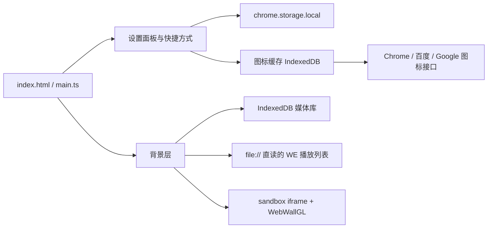

# LocalTab · 本地优先的新标签页

LocalTab 是一个以 Chrome Manifest V3 扩展形式交付的新标签页。它用你自己的本地图片、视频和 Wallpaper Engine 场景包作为背景，提供可自定义的快捷方式、可切换来源的图标缓存和一个轻量搜索框。所有数据保存在本机，核心体验在断网时依然完整可用。

当前版本 `0.1.0`，处于 MVP 开发阶段。项目基于 AI 辅助开发，详见[关于 AI 辅助开发](#关于-ai-辅助开发)；以 MIT 许可证开源。

## 功能特性

### 壁纸与背景

- **本地媒体库**：支持 JPEG、PNG、WebP、MP4、WebM，可拖放、单文件选择或整文件夹导入。
- **导入校验**：检查 MIME、空文件、浏览器解码能力，并按 4 MB 分块计算 SHA-256 指纹用于去重。
- **重复处理**：名称或内容重复时可选择跳过、重命名导入或覆盖，并可对整批冲突套用同一选择。
- **播放模式**：随机、顺序、固定当前；自动切换间隔 1–1440 分钟，视频静音循环播放。
- **控制栏**：左下角提供上一张 / 暂停 / 下一张，可折叠为单个按钮，折叠状态跨标签页保留。
- **缩略预览**：图片使用自身画面，视频解码首帧并等比缩放到宽度 ≤320 px，场景包使用渲染首帧。
- **Wallpaper Engine 播放列表**：导入 `config.json` 后收集所有 profile / 显示器的 `playlist.items` 与 `playlists` 路径并去重。
- **场景包渲染**：支持任意 PKGV 版本的 `.pkg`（仅校验 `PKGV` 魔数），在隔离的 sandbox iframe 中由 WebWallGL 渲染完整场景、脚本与效果，并支持指针交互（视差、光标跟随、拖拽类场景）。
- **失效条目处理**：缺失或不受支持的条目自动跳过并标记，不进入随机池；配置中的 Web 壁纸等不支持项只按类型计数提示。

### 快捷方式

- 最多 18 个，支持新增、编辑、删除、拖拽排序，以及上移 / 下移的替代操作。
- 网址仅接受 HTTP/HTTPS，名称长度受限。
- 图标来源可在设置中切换：
  - **Chrome 内置**：浏览器 favicon 接口；
  - **国内源**：百度；
  - **国际源**：Google。
- 远程图标仅在用户手势内按需申请域名权限，结果统一转为 64×64 PNG 并以 `icon:<来源>:<域名>` 为键缓存到 IndexedDB。命中缓存或离线时直接使用本地缓存，缓存缺失则回退首字母图标，不会出现破图。

### 搜索

设置中可选择百度、Google、必应、搜狗、360 搜索、DuckDuckGo、Yandex 之一作为搜索框引擎（Chrome 扩展无法读取浏览器默认搜索引擎，因此由扩展提供等价选项）。

### 设置与备份

- 设置、快捷方式和折叠状态自动保存，在新标签页中恢复。
- 导出 / 导入带 `schemaVersion` 的 JSON 配置，包含设置、快捷方式、播放列表元数据和当前来源的图标缓存，恢复后可离线显示图标。
- 媒体文件本身留在本机 IndexedDB，不随 JSON 导出。

### 界面细节

- 内容靠上排布，不显示时钟或日期，避免遮挡壁纸；首次空白状态才显示引导文案。
- 搜索框与快捷方式常态近乎透明；悬停或键盘聚焦时背景暗化并模糊，两类控件同步突出。
- 设置面板标题栏在滚动时固定顶部，支持点击面板外区域、按 Esc 或点击关闭按钮退出；壁纸列表可单独折叠，并支持按名称实时过滤。

## 技术栈

| 层次                   | 选型                                                                                                        |
| ---------------------- | ----------------------------------------------------------------------------------------------------------- |
| 语言 / 构建            | TypeScript 5.6、Vite 8（`tsc -b && vite build`）                                                            |
| 扩展形态               | Chrome Manifest V3，`chrome_url_overrides.newtab` 接管新标签页                                              |
| 设置存储               | `chrome.storage.local`（本地预览时回退到 `localStorage`）                                                   |
| 媒体 / 图标 / 播放列表 | IndexedDB（`localtab-media` 数据库）                                                                        |
| 场景渲染               | [WebWallGL](https://www.npmjs.com/package/webwallgl) 3.0，运行在 `scene-renderer.html` 的 sandbox iframe 中 |



## 使用的开源项目

本项目在实现过程中使用了以下开源软件，感谢作者与社区的贡献。

### 运行时依赖

| 项目                                                                          | 版本    | 用途                                                                          | 许可证  |
| ----------------------------------------------------------------------------- | ------- | ----------------------------------------------------------------------------- | ------- |
| [WebWallGL](https://www.npmjs.com/package/webwallgl)                          | 3.0.0   | 在浏览器中渲染 Wallpaper Engine `.pkg` 场景，解析场景层、脚本、效果与指针交互 | MIT     |
| [Mediabunny](https://mediabunny.dev/)（经 WebWallGL 间接引入）                | 1.61.x  | 媒体容器与编码解码能力                                                        | MPL-2.0 |
| [Chrome Extensions API 类型定义](https://www.npmjs.com/package/@types/chrome) | 0.0.268 | 扩展 API 的 TypeScript 类型（仅编译期）                                       | MIT     |

### 开发与构建工具

| 项目                                          | 版本 | 用途                                                                      | 许可证     |
| --------------------------------------------- | ---- | ------------------------------------------------------------------------- | ---------- |
| [TypeScript](https://www.typescriptlang.org/) | 5.9  | 类型系统与编译检查（`tsc -b`）                                            | Apache-2.0 |
| [Vite](https://vite.dev/)                     | 8.3  | 开发服务器与生产构建，双入口打包（含 Rolldown、Lightning CSS 等底层组件） | MIT 及其他 |

各依赖的完整许可证文本可在 `node_modules/<包名>/LICENSE` 中查看；本项目直接分发的第三方组件声明见 [THIRD_PARTY_NOTICES.md](./THIRD_PARTY_NOTICES.md)。

## 关于 AI 辅助开发

本项目**基于 AI 辅助开发**：需求梳理、架构设计、功能实现、文档撰写与代码审查过程均大量借助 AI 编程助手（GitHub Copilot 及其代理模式）完成。

需要说明的是：

- 所有代码都经过人工确认、构建验证与浏览器实际运行测试后才被采纳；
- AI 生成的代码不引入来源不明的第三方代码，依赖项均来自公开的开源包；
- 模型建议可能存在疏漏，项目仍处于 MVP 阶段，缺陷与限制请见[已知限制](#已知限制)；
- 如果你基于本项目二次开发，建议同样保持"人工复核 + 实际测试"的流程。

## 目录结构

```text
.
├─ index.html                 # 新标签页入口
├─ scene-renderer.html        # 场景包渲染宿主（sandbox iframe）
├─ public/manifest.json       # MV3 清单（构建时复制到 dist）
├─ src/
│  ├─ main.ts                 # 界面、导入、播放、快捷方式、备份等主逻辑
│  ├─ models.ts               # 数据类型、默认设置、搜索引擎定义
│  ├─ storage.ts              # 设置读写与字段归一化
│  ├─ media-db.ts             # IndexedDB 媒体库、哈希、预览图
│  ├─ icon-resolver.ts        # 图标来源、权限、抓取与缓存
│  ├─ wallpaper-engine.ts     # config.json 解析、file:// 直读、project.json
│  ├─ scene-renderer.ts       # sandbox 内场景加载与指针转发
│  └─ style.css               # 全部样式
└─ vite.config.ts             # 双入口构建（index / scene-renderer）
```

## 本地开发与安装

需要 Node.js LTS 与 Chromium 内核浏览器（Chrome / Edge）。

```bash
npm install
npm run dev      # 本地预览（设置写入 localStorage）
npm run build    # TypeScript 检查 + 生产构建，输出 dist/
npm run preview  # 预览构建产物
```

以扩展方式加载：

1. 执行 `npm run build`；
2. 打开 `chrome://extensions`，开启右上角“开发者模式”；
3. 点击“加载已解压的扩展程序”，选择项目中的 `dist` 目录；
4. 新建标签页即可使用。

> `npm run dev` 只是原型预览，不具备 `chrome.storage`、`chrome.permissions` 和 sandbox iframe 等扩展能力，完整功能需加载 `dist`。

## 使用要点

- **壁纸**：设置 → 壁纸与背景 → 导入图片 / 视频 / `.pkg`，或选择文件夹批量导入。超过浏览器存储配额时会给出提示，扩展开启了 100 MB 以上的文件导入（大视频走 `file://` 流式读取，不整文件读入内存）。
- **Wallpaper Engine 背景**：选择“Wallpaper Engine 播放列表” → 选择 WE 配置 → 在 `chrome://extensions` 中为本扩展启用“允许访问文件网址” → 点击“获取权限”校验。校验通过后按配置里的绝对路径直读文件，只播放已确认可用的条目。
- **图标授权**：切换到百度 / Google 来源或点击“按当前来源重新获取图标”时，浏览器会请求对应域名权限；拒绝授权仍可使用 Chrome 内置接口或首字母回退。
- **键盘**：搜索框内按 Enter 搜索；Esc 关闭设置面板并将焦点返回入口。

## 数据与隐私

- 扩展只申请 `storage` 权限、`file:///*` 主机权限，以及可选的 `favicon` 与图标服务域名权限；不读取浏览历史、书签、Cookie、剪贴板或地理位置。
- 媒体、图标、播放列表与预览图全部保存在本机 IndexedDB，不上传任何服务器。
- 唯一的网络请求是用户显式选择的图标来源，且仅在对应权限已授予、本地缓存未命中时发起。
- 导出的备份只包含 LocalTab 自身的设置与资源元数据，不含浏览器数据。

## 已知限制

- 尚处于 0.1.0 开发阶段，未完成真实扩展环境下的全部人工验收（断网、重启、压力测试等）。
- 存储受浏览器本地配额限制，暂无可视化配额统计与清理流程。
- ZIP 媒体备份、多播放列表、Web 壁纸（`index.html`）渲染、不受支持视频编码的转码均未实现。
- 部分场景包受渲染引擎限制可能出现画面偏暗；场景渲染依赖 WebGL 与设备性能。
- 暂无自动化测试。

## 相关文档

- [软件需求与任务规格说明](./LocalTab_软件需求与任务规格说明.md)
- [开发进度](./LocalTab_开发进度.md)
- [第三方声明](./THIRD_PARTY_NOTICES.md)（WebWallGL，MIT License）
- [MIT 许可证](./LICENSE)

## 致谢

感谢 [WebWallGL](https://github.com/oneincase/webwallgl) 提供的场景渲染能力，以及 TypeScript、Vite、Mediabunny 等开源项目的作者与维护者。

## 许可

本项目采用 [MIT License](./LICENSE)。所依赖的第三方组件许可信息见 [THIRD_PARTY_NOTICES.md](./THIRD_PARTY_NOTICES.md)。
